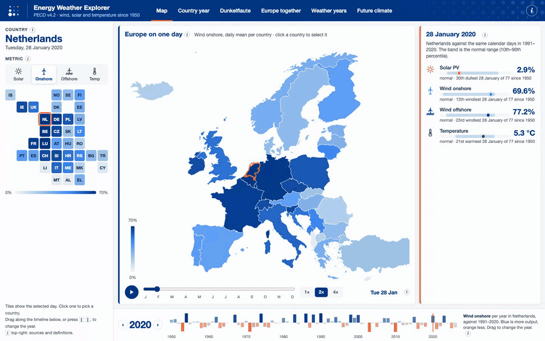
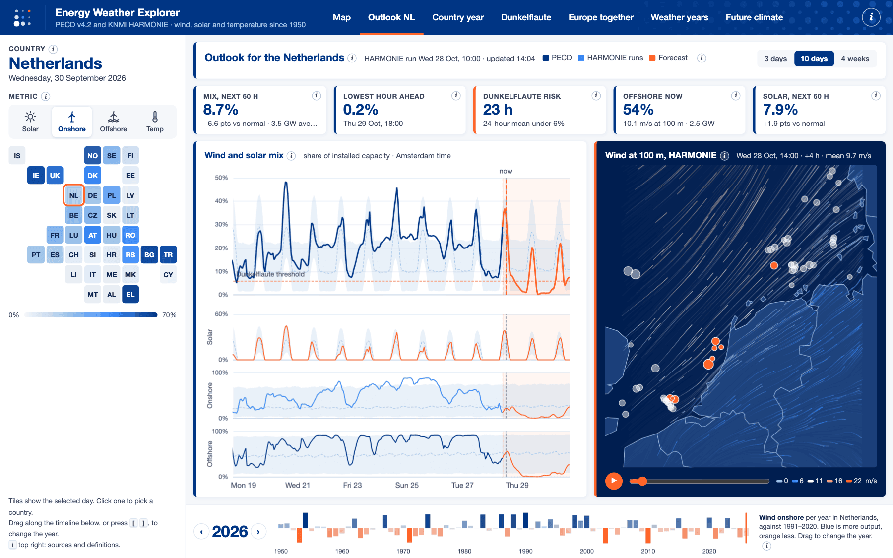
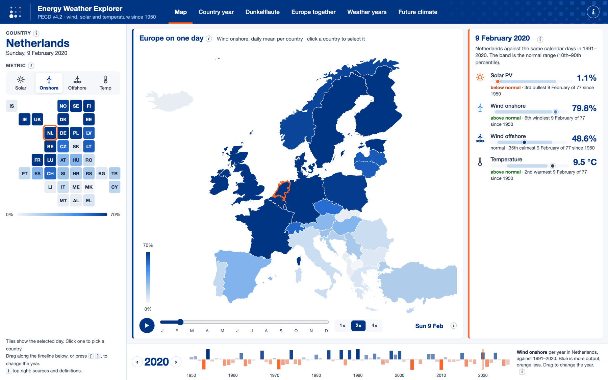
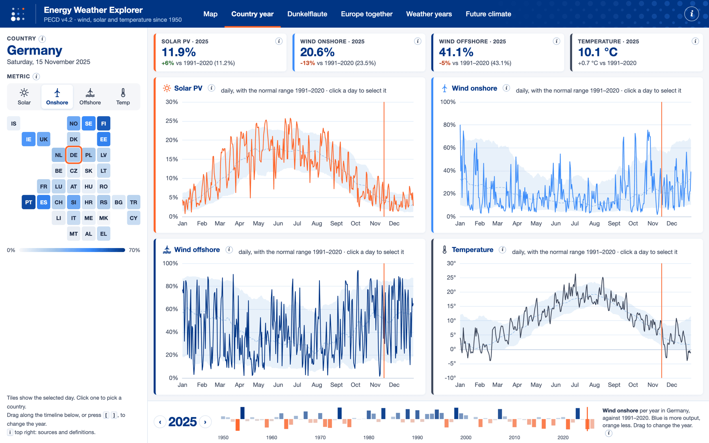
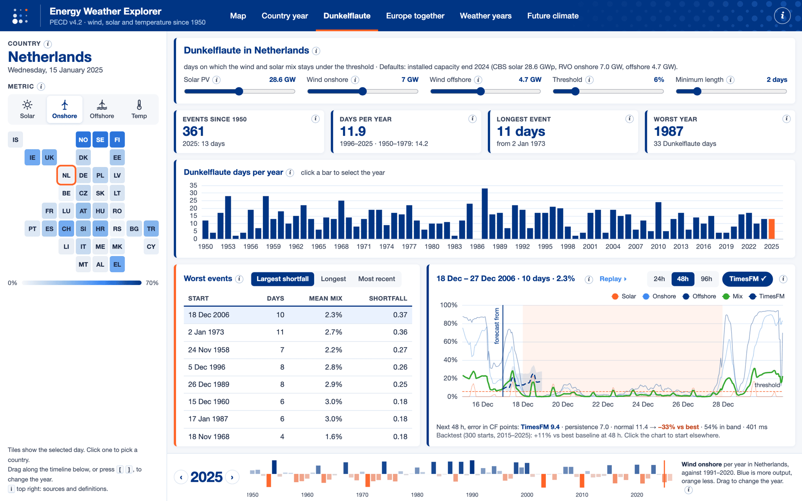
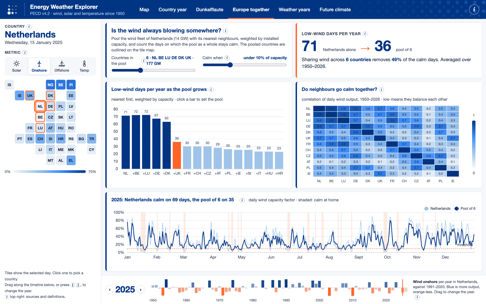
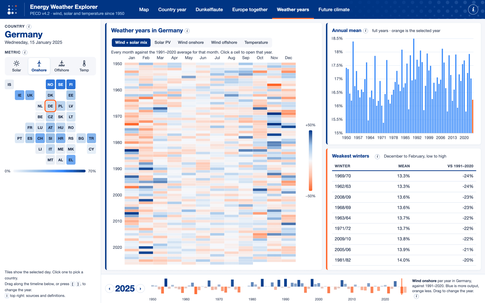
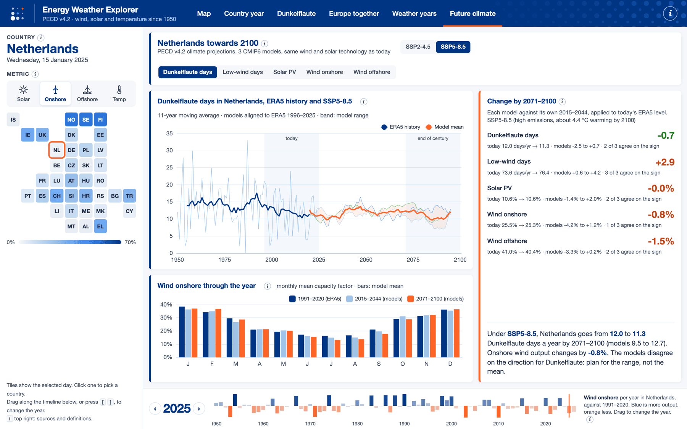

<h1 align="center">Energy Weather Explorer</h1>

<p align="center">
  <b>How the weather drives wind and solar power in Europe, every day since 1950.</b><br />
  Dunkelflaute spells, what pooling wind across countries buys you, what climate models expect up to 2100,
  and a live outlook for the Netherlands from the KNMI HARMONIE forecast.
</p>

<p align="center">
  <a href="https://energy-weather.frankwiersma.workers.dev"></a>
  <a href="https://cds.climate.copernicus.eu/datasets/sis-energy-pecd"></a>
  <a href="https://github.com/frankwiersma/energy-weather-explorer/actions/workflows/refresh.yml"></a>
  <a href="LICENSE"></a>
</p>

<p align="center">
  <a href="https://energy-weather.frankwiersma.workers.dev"></a>
</p>

<p align="center">
  <a href="https://energy-weather.frankwiersma.workers.dev"><b>Open the app</b></a> ·
  <a href="#what-it-shows">What it shows</a> ·
  <a href="#outlook-for-the-netherlands">Outlook NL</a> ·
  <a href="#forecasting-with-timesfm">TimesFM in the browser</a> ·
  <a href="#data">Data</a> ·
  <a href="#updates">How it stays current</a>
</p>

---

## A few things the data shows

- **The Netherlands has about 12 Dunkelflaute days a year.** That is a run of at least two days on which the
  wind and solar mix stays under 6% of installed capacity. The worst spell since 1950 was 18 to 27 December 2006:
  ten days at 2.3%.
- **Sharing wind only helps with countries whose weather differs.** Belgium's wind moves almost in step with the
  Dutch (r = 0.93), so adding it changes nothing. Germany and above all the UK do: pooled with its five nearest
  neighbours, weighted by installed capacity, the Netherlands goes from 71 to 36 calm days a year.
- **A time-series model can see the next day or two coming, not the next season.** TimesFM beats persistence and
  the hourly normal by 11–35% up to 48 hours ahead, and adds nothing for the months ahead.
- **KNMI's HARMONIE forecast, put through curves learned from PECD, tracks PECD closely.** Over its first day
  it matches PECD with a correlation of 0.95–0.97 for onshore wind, offshore wind and solar.
- **Climate change barely moves average wind and solar output in these models.** The change by 2100 is a few
  percent, often smaller than the disagreement between models.

## What it shows

The whole app fits on one screen. A tile map of Europe picks the country and shows the selected day, a timeline
along the bottom picks the year, and all views share one selected date. Every number has an ⓘ that explains it.

<p><a href="docs/outlook.png"></a><br /><b>Outlook NL</b>: the past four weeks and the next 60 hours of Dutch wind and solar output against the normal range, with the HARMONIE wind at hub height animated over the North Sea wind farms.</p>

<table>
  <tr>
    <td width="50%"><a href="docs/map.png"></a><br /><b>Map</b>: Europe on one day, with a day slider and play controls. Per metric the normal range and the day's rank since 1950.</td>
    <td width="50%"><a href="docs/country.png"></a><br /><b>Country year</b>: daily wind, solar and temperature against the 1991–2020 normal range, with wind nationally or per PECD zone.</td>
  </tr>
  <tr>
    <td><a href="docs/dunkel.png"></a><br /><b>Dunkelflaute</b>: calm, dark spells for an adjustable capacity mix and threshold, with hourly detail, a replay on the map and a TimesFM forecast.</td>
    <td><a href="docs/europe.png"></a><br /><b>Europe together</b>: how pooling wind with neighbouring countries reduces calm days, and how strongly neighbours move together.</td>
  </tr>
  <tr>
    <td><a href="docs/years.png"></a><br /><b>Weather years</b>: every month since 1950 against normal, and winters ranked.</td>
    <td><a href="docs/future.png"></a><br /><b>Future climate</b>: Dunkelflaute, low-wind days and capacity factors to 2100 under SSP2-4.5 and SSP5-8.5.</td>
  </tr>
</table>

## Outlook for the Netherlands

The Outlook NL view joins three parts on one hourly axis, so the recent past and the next days read as one
series on the PECD scale:

| Part | Source | Covers |
|---|---|---|
| PECD | capacity factors as published | up to the last PECD month |
| HARMONIE runs | the first day of each earlier KNMI HARMONIE-AROME run | the weeks since then |
| Forecast | the newest HARMONIE-AROME Cy43 run, 2 km grid | 60 hours ahead |

Weather becomes capacity factors the way PECD makes them, learned back from PECD itself. For every Dutch PECD
zone, a curve maps the zone's 100 m wind speed to that zone's capacity factor; for solar, a curve per month maps
radiation over land to the national PV capacity factor. The curves are fitted on ERA5 2016–2024, averaged over
each zone the way PECD averages it, and scored on 2025. HARMONIE is then checked against PECD itself: the first
day of archived runs since January 2026 goes through the curves, and per zone a small scale on HARMONIE's wind
speed (and one on its radiation) is chosen that best reproduces PECD. `pipeline/transfer.json` holds the curves,
the scales and the scores. On the archived runs of 2026 the first forecast day matches PECD with a correlation
of 0.95 for onshore wind, 0.96 for offshore wind and 0.97 for solar (mean error 4.5, 5.4 and 2.2 percentage
points). National values use the same capacity weights as the rest of the app.

The view shows the mix and each technology against the 1991–2020 normal range for that hour, the forecast hours
at which the 24-hour mean drops under the Dunkelflaute threshold, and the HARMONIE wind at 100 m as moving
particles over the offshore wind farms. The forecast is one deterministic run: the most likely course, not the
spread around it.

### Built with

[ECharts](https://echarts.apache.org/) for the charts, [Vite](https://vite.dev/) for the build,
[ONNX Runtime Web](https://onnxruntime.ai/) for TimesFM, and Python with pandas for the data pipeline. No framework,
no backend: a static site on Cloudflare Workers, refreshed by a GitHub Action.

## Data

All data comes from the Climate Data Store (dataset `sis-energy-pecd`, PECD v4.2):

| Key | Variable | Technology | Aggregation |
|---|---|---|---|
| `spv` | Solar PV capacity factor | 60–63: rooftop industrial, rooftop residential, utility fixed, utility tracking | country (NUTS 0), PV types weighted by national capacity per type |
| `won` | Wind onshore capacity factor | 30, existing fleet, resource grade B | PECD onshore zones, weighted by installed capacity per zone |
| `wof` | Wind offshore capacity factor | 20, existing fleet, resource grade B | PECD offshore zones, weighted by operating capacity per zone |
| `t2m` | 2 m temperature | | country (NUTS 0) |

History is ERA5 from 1950 to the latest month. Projections (2015–2100) come from three CMIP6 models
(EC-Earth3, MPI-ESM1-2-HR, CMCC-CM2-SR5) under SSP2-4.5 and SSP5-8.5, with the same wind technology and fleet
weights as the history; solar projections exist for utility-scale fixed PV. The models match ERA5 mean capacity
factors but overstate how long calm spells last, so each model is compared with its own 2015–2044 baseline and
that change is added to today's ERA5 level.

### From zones to countries

PECD delivers wind per zone (26 countries have several onshore zones, Germany 7 and France 15), and solar per
PV type. A national capacity factor is the capacity-weighted mean of those, so the weights matter:

- **Wind within a country:** no official table of installed capacity per PECD zone is published, so
  `pipeline/zone_capacity.py` builds one. Every turbine in GOWIRES (onshore) and the Open European offshore wind
  turbine database is assigned to the zone of its own country it lies in, using the PECD region masks. Zones
  without turbines get no weight, for example the planned offshore areas. The databases give good shares within
  a country but not reliable national totals, so they are only used for those shares.
- **Between countries and technologies** (onshore against offshore, solar per PV type, the default Dunkelflaute
  mix outside NL and DE, pooling in Europe together): national capacities from ENTSO-E ERAA 2025 for 2028.
- Country year can show each zone separately, with its share of the national capacity.

## Forecasting with TimesFM

The Dunkelflaute view can forecast the next 24, 48 or 96 hours of the wind and solar mix with
[TimesFM 3.0](https://huggingface.co/google/timesfm-3.0-pytorch), Google's time-series foundation model,
running in the browser with ONNX Runtime Web (int8 export, 353 MB, downloaded once and cached).

It is only used where it beats simple baselines. Backtest on 300 random starting hours in 2015–2025,
improvement in mean absolute error over the better of persistence and the 30-day hourly normal:

| Mix | 24 h | 48 h | 96 h |
|---|--:|--:|--:|
| Netherlands | +26% | +11% | +6% |
| Germany | +35% | +25% | +5% |

The p10–p90 band covers 77–81% of the truth. For daily values months ahead and for annual temperature it
does not beat the climate normal or a linear trend, so it is not offered there.

## Pipeline

| Script | What it does |
|---|---|
| `pipeline/fetch.py` | Downloads the history; asks CDS which months exist and fetches only what is missing |
| `pipeline/zone_capacity.py` | Builds `zone_capacity.csv` (installed wind capacity per PECD zone) and `national_capacity.csv` (ERAA 2025 per country and technology); run when the sources are updated |
| `pipeline/fetch_projections.py` | Downloads the projections (once, about 2.2 GB) |
| `pipeline/process.py` | Builds `public/data/`: capacity-weighted daily series per country, per-zone wind, daily values per year for the map, hourly data for NL and DE, the national wind fleets for pooling, `meta.json` |
| `pipeline/process_projections.py` | Adds yearly indicators per country in `public/data/future/`; `--hist-only` refreshes the ERA5 part without the projection downloads |
| `pipeline/refresh.py` | Checks CDS for a new month, then fetches, rebuilds and checks the result |
| `pipeline/outlook_geo.py` | Builds `nl_cells.json` (the ERA5 cells of each Dutch PECD zone) and `farms.json` (offshore wind farms for the map) |
| `pipeline/fetch_era5.py` | Downloads ERA5 100 m wind and radiation for 2016–2025 per cell, from the ERA5 point time series |
| `pipeline/harmonie.py` | Streams HARMONIE runs from the KNMI Data Platform and keeps the zone averages and a coarse wind field; `--sample` fetches archived runs for calibration |
| `pipeline/calibrate.py` | Fits the wind and solar curves on ERA5 against PECD and scales HARMONIE to PECD; writes `transfer.json` |
| `pipeline/outlook.py` | Joins PECD and HARMONIE into `data/outlook/NL.json` and `wind.bin` |

CDS charges one unit per year in a request (limit 300) and caps queued requests per dataset, so the scripts
send one request per variable and run at most three at a time.

## Updates

`.github/workflows/refresh.yml` runs twice a week. PECD adds a month about three weeks after it ends, so
most runs stop after one request. When there is a new month it fetches the running year, rebuilds the data,
checks it (newest month present, no country lost, no gaps) and commits it; the push deploys the site. The
ERA5 history lives in the Actions cache; after a cache miss it is downloaded again.

It needs one repository secret, `CDSAPI_KEY`: the API key from your CDS profile, with the PECD licence
accepted on the dataset page.

`.github/workflows/outlook.yml` runs every three hours. It streams the newest HARMONIE run and any runs missing
since PECD's last month, rebuilds the outlook and force-pushes the two files as a single commit to the `outlook`
branch. The site reads them from there, so the outlook updates without a deploy. It needs one more secret,
`KNMI_API_KEY`: a registered key for the KNMI Data Platform Open Data API.

## Run locally

```bash
bun install
bun run dev
```

To rebuild the data you need a CDS account and `~/.cdsapirc`:

```bash
uv venv .venv && uv pip install --python .venv/bin/python cdsapi pandas requests xarray netCDF4 eccodes
.venv/bin/python pipeline/fetch.py
.venv/bin/python pipeline/fetch_projections.py
.venv/bin/python pipeline/process.py
.venv/bin/python pipeline/process_projections.py
```

The outlook needs a KNMI key as well:

```bash
.venv/bin/python pipeline/fetch_era5.py
KNMI_API_KEY=... .venv/bin/python pipeline/harmonie.py --sample 5
KNMI_API_KEY=... .venv/bin/python pipeline/harmonie.py
.venv/bin/python pipeline/calibrate.py
.venv/bin/python pipeline/outlook.py
VITE_OUTLOOK_URL=/outlook bun run dev   # with public/outlook linked to data/outlook
```

## Deploy

A static site on Cloudflare Workers (static assets are free and unlimited). Every push to `main`, including
the data commits of the refresh workflow, builds and deploys through Cloudflare Workers Builds with
`bun install && bun run build` and `npx wrangler deploy`. To deploy by hand:

```bash
bun run build
npx wrangler deploy
```

The ONNX Runtime WASM file (27.8 MB) is larger than the 25 MiB per-file limit for static assets, so it is
loaded from R2 together with the TimesFM weights.

## Sources and licence

- Copernicus Climate Change Service (2024): Climate and energy related variables from the Pan-European
  Climate Database derived from reanalysis and climate projections. C3S Climate Data Store (CDS),
  DOI [10.24381/cds.f323c5ec](https://doi.org/10.24381/cds.f323c5ec). Licence CC BY 4.0. Neither the
  European Commission nor ECMWF is responsible for any use of this information.
- Wind turbine locations: GOWIRES v1.0 ([10.5281/zenodo.18768952](https://doi.org/10.5281/zenodo.18768952), CC BY 4.0)
  and the Open European offshore wind turbine database ([Zenodo record 17311571](https://zenodo.org/records/17311571), ODbL).
- National capacities: ENTSO-E, European Resource Adequacy Assessment 2025, input data (target year 2028).
- Installed capacities for the NL and DE default mix: CBS and RVO (Netherlands), Bundesnetzagentur (Germany), end 2024.
- Weather forecast: KNMI HARMONIE-AROME Cy43 P1, KNMI Data Platform, CC BY 4.0.
- Reanalysis (to fit the outlook's curves): Copernicus Climate Change Service, ERA5 hourly time series on single
  levels, derived from [10.24381/cds.adbb2d47](https://doi.org/10.24381/cds.adbb2d47). Contains modified
  Copernicus Climate Change Service information.
- Map outlines: © EuroGeographics for the administrative boundaries (Eurostat GISCO).
- TimesFM 3.0 by Google Research, Apache 2.0.

The code is MIT licensed. The data in `public/data/` is derived from the sources above and keeps their licences.
